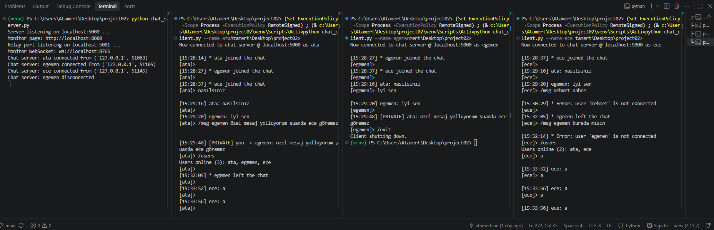
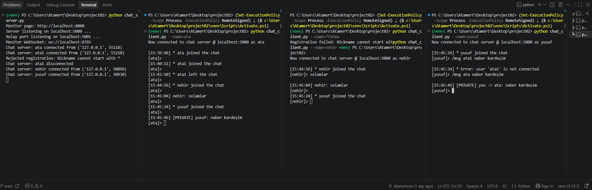
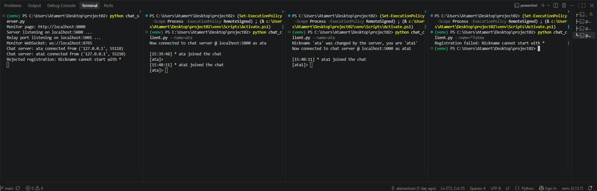
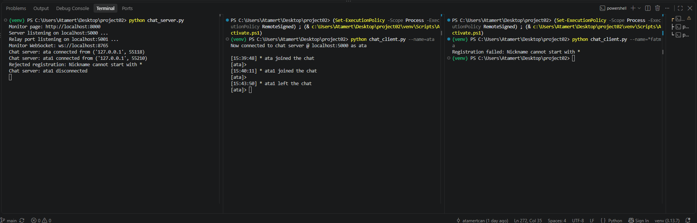
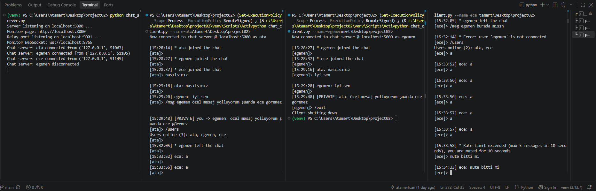
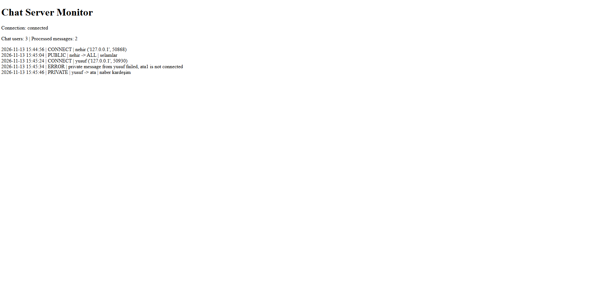
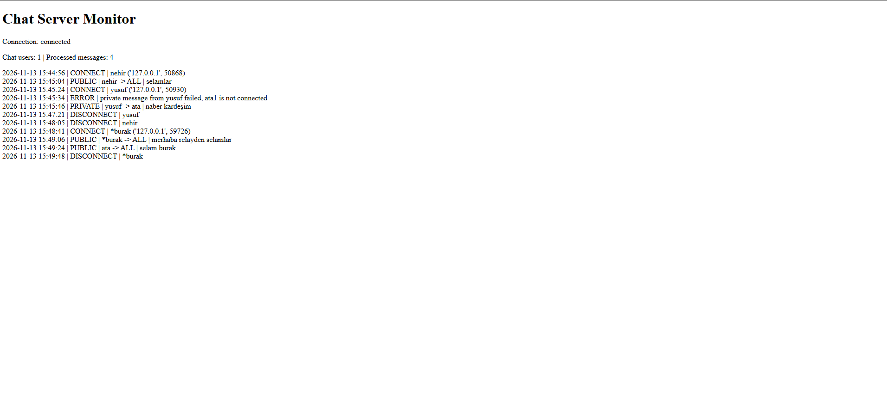
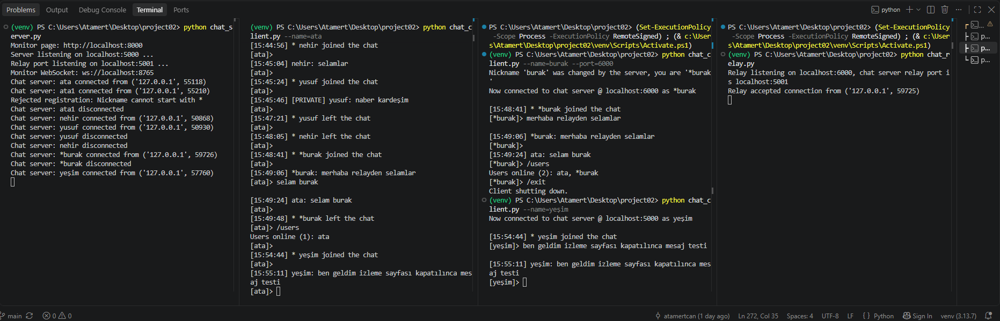
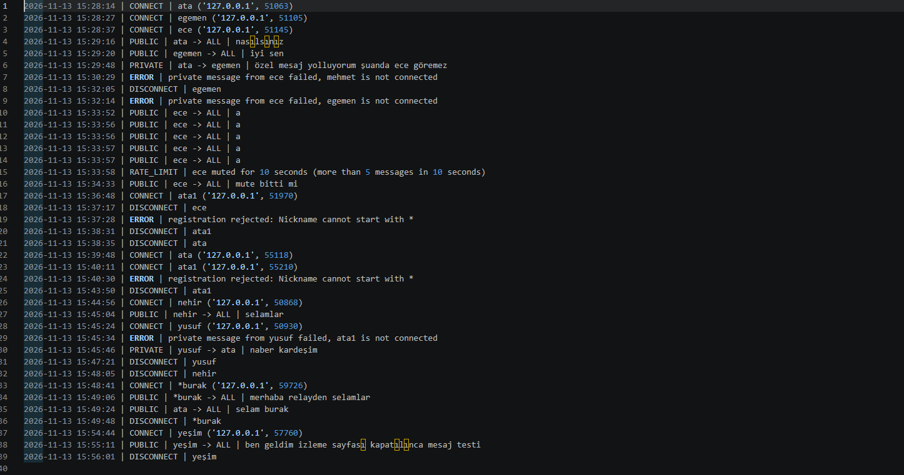
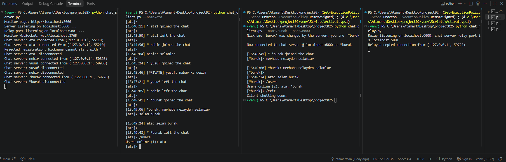

# Basic functional tests

Manual tests T01-T07, run on one computer (`localhost`). Screenshots are in this folder.
The nicknames in the screenshots (ata, egemen, ece, ...) are just test names.

## T01 - Public chat
Public messages reach every client with a timestamp and the sender's nickname. `/users` shows the user list.

## T02 - Private chat
A private message reaches only the recipient, the third client sees nothing. Messaging a nickname that is not connected returns an error.

## T03 - Nicknames
A name that is already taken gets a different one (`ata1`). A name starting with `*` is rejected.

## T04 - Disconnection
`/exit` (first screenshot above) and closing the client window both remove the user from the list, the others are notified and the server keeps running.

## T05 - Rate limiting
More than 5 messages in 10 seconds mutes the user for 10 seconds, the user is told why.

## T06 - Logs and live monitoring
Events appear on the monitoring page without a refresh, with the user count and the processed message count.

Later in the same session. A message sent to several users is counted once.

The chat keeps working after the monitoring page is closed.

The log file (`chat_server.log`).

## T07 - Relay (optional)
A client connected through the relay gets the `*` prefix (`*burak`), chats with a directly connected client and its exit is cleaned up.

